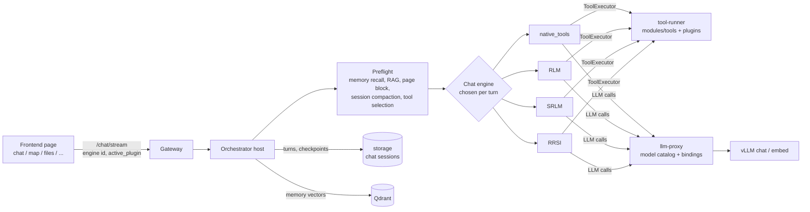

# Orchestrator Architecture

How the AIv2 chat orchestrator works: the engines (native_tools, RLM, SRLM, RRSI), the session compactor, tool use, and short- and long-term memory.

Source root: `backend/services/orchestrator/src/` (paths below are relative to it unless stated).

---

## 1. The big picture

The orchestrator is a **host** that owns everything engines share: the stored conversation, compaction, memory, RAG, page context and the tool catalog. **Engines** are drop-in packages that only decide how to answer one turn. Because the host owns the conversation, the user can switch engines mid-chat without losing anything.

### Key principles

- **Nothing names an engine.** `orchestrators/registry.py` scans `orchestrators/*/manifest.json`. An engine exists because its folder exists. `chat_engine_resolve.py` picks the stream entry from the manifest's `extensions.stream_entry`.
- **Numbers come from configuration.** Context window and output limits come from the llm-proxy model catalog (`host_adapters/model_catalog.py`). Thresholds come from `config.py` settings (env-overridable). Prompts are `.md` files. Tool behaviour comes from each tool's `tool.json`.
- **Turns outlive the HTTP connection** (`chat_turns.py`). A turn runs as a background task that buffers its SSE events. Leaving or reloading the page only ends the subscription; only an explicit stop cancels the turn.

---

## 2. Engine registry and manifests

Each engine folder (`orchestrators/<id>/`) contains:

| File | Role |
|---|---|
| `manifest.json` | id, kind, capabilities, `config_schema`, `settings_ui`, `session_binding`, `tools_binding`, `stream_entry` |
| `adapter.py` | lifecycle operations (create / run / status / shutdown) |
| `chat_stream.py` or `runtime/` | the actual turn logic |

Shared host code lives in `orchestrators/_shared/` and `orchestrators/host_adapters/`:

- `manifest_config.py`: merges the manifest defaults with the per-request `orchestrator_config`.
- `engine_turn.py`: runs one turn of *any* registered engine. Controllers (SRLM, RRSI) use it to drive other engines without knowing which ones exist. Engines with a durable `session_binding` get an isolated engine session per call, so parallel trials never share a kernel or memory.
- `host_context.py`: per-turn prompt blocks (memory, RAG, page, clock, persona) passed to engines as `<name>_prompt_block` kwargs. Engines with a persistent transcript swap these sections in place each turn so they never pile up.
`GET /orchestrators` (`routes.py`) publishes each engine's public manifest, with filters by capability, operation and kind. The chat settings build their engine pickers from this list.

---

## 3. The four engines

### 3.1 native_tools

`graph/native_tools_engine.py`. A classic tool-calling loop over the OpenAI `tools=[...]`, `tool_choice="auto"` channel:

- the model may emit any number of `tool_calls` in one streamed response;
- the engine executes them through `ToolExecutor`, appends the results, and loops until a final text answer or `max_steps`;
- an explicit `orchestrator_config.tool_ids` narrows the tool list. If none of those tools are allowed for the user/page, it falls back to normal selection and logs a warning.

It is the simplest and fastest engine, and the default peer for SRLM.

### 3.2 RLM (Recursive Language Model)

`orchestrators/rlm/` with a large `runtime/`. The model works inside a **persistent Python kernel**:

- `runtime/kernel.py` + `runtime/worker.py`: a subprocess IPython worker that speaks JSONL RPC over stdin/stdout. It is sandboxed with bwrap or landlock when available (`bwrap_jail.py`, `landlock_jail.py`).
- `runtime/session.py`: the RLM session (kernel, child sub-agents, inbox, harness, turn loop).
- `runtime/handlers.py`: host-side RPC handlers the kernel calls (`host_request`), including tool calls. A tool can only be called if its id is in the session's `tool_ids`.
- Tools are exposed to the kernel as **callables** (`tools_binding.mode = kernel_callable`). `_shared/tool_surface.py` builds each tool's alias, the namespace it lives under, and the prompt section rendered from the tools' JSON Schemas.
- Sub-agents: RLM can spawn child sessions (depth-tracked). Each child gets `subagent_tool_ids`.
- `runtime/context_budget.py`: hard-caps every request so `estimated_input + max_tokens < context_length` of the deployed model.
- `runtime/compaction.py`: RLM's own transcript compaction (see section 5.3).

**RLM's memory ladder** (`host_adapters/rlm_chat_memory.py`): warm session → disk snapshot → hub conversation.

- RLM keeps its own transcript (code cells, REPL output) per chat.
- `hub_turns.json` records which hub turns RLM itself served.
- When other engines answered turns in between, those turns are **appended** to RLM's transcript before it continues.
- When the hub conversation no longer reaches RLM's last turn (for example, after session compaction folded it), the transcript is **reseeded** from the hub conversation (checkpoint + verbatim tail).

### 3.3 SRLM (SelfReflect)

`orchestrators/srlm/chat_stream.py`, based on Kirchhof et al., 2025. Each turn has two phases:

1. **search:** sample K answers. With `peer_engine` empty (the paper setting and the manifest default), samples come straight from the chat model with no tools. With `peer_engine` set (for example `native_tools`), each sample is **one full turn of that engine**, tools included.
2. **select:** a configured summary strategy (`sample_and_summarize`, `greedy`, `cot`, ...) turns the sample distribution into the answer: main possibility, alternatives and their relative likelihood.

Duplicate read-only tool calls across samples are expected. Side-effecting tools are deduplicated per turn (section 6.4).

> SRLM needs `peer_engine` set to a tool-using engine for any task that needs tools. Otherwise its samples are produced without tools, and with tool data missing the answer can contain invented values.

### 3.4 RRSI

`orchestrators/rrsi/`. A controller that evolves a **harness** (instructions/policy) for a policy engine:

- **Evolve turns** run `rounds_per_turn` RRSI rounds on the conversation's evolve set and answer with the best-judged trial of the accepted harness.
- **Serve turns** (no rounds due, or the horizon is spent) stream the policy engine live under the incumbent harness.

Trials run through `engine_turn.py`, so each trial is an isolated engine session.

---

## 4. Turn lifecycle (host side)

For each `/chat/stream` turn:

1. **Resolve engine:** `chat_engine_resolve.py` maps the requested id to its stream entry. The engine can differ from the previous turn's engine.
2. **Model limits:** `prepare_orchestrator_config` stamps `context_length` and `max_output_tokens` from the model catalog onto the config.
3. **Session workspace** (`session_workspace.py`): loads stored turns, attaches session files and cases, and runs **session compaction** (section 5.1).
4. **Preflight blocks** (`host_context.py`):
   - memory recall (short-term + long-term, section 7);
   - native RAG over the shared corpus (`rag/`, collection `NATIVE_RAG_COLLECTION`);
   - the **page block** for the frontend page the user is on (`active_plugin`);
   - pinned facts (`pinned_facts.py`), clock, persona.
5. **Tool selection** for this page and turn (section 6.2).
6. **Long input:** if the user message is larger than `trigger_ratio` × the window, `context/long_input.py` splits it. Parallel workers extract task-relevant notes, and the engine receives a digest instead of the raw text.
7. **Engine runs** and streams SSE events (`hub_stream.py`, `hub_sse.py`).
8. **Persist:** the turn is stored. Memory saves the turn (short-term) and distils long-term facts in the background.

---

## 5. Compaction

There are three layers. They write **the same checkpoint format**, so whichever engine continues sees a consistent memory.

### 5.1 Session compactor (host, all engines)

`context/session_compactor.py`. Prompt: `context/session_compact_prompts/summarizer.md`.

- **Budget from the model catalog:**
  - `window` = the model's `context_length`;
  - `output_reserve` = `max_output_tokens`, capped at `max_output_ratio` × window;
  - `history` = the window share allowed for conversation (`history_share`);
  - `trigger` = `history × trigger_ratio`;
  - `keep` = `history × keep_recent_ratio`.

  All ratios are settings, not constants.
- **What is measured:** the conversation the engine will receive: the carried checkpoint, the stored turns since it, and the new user message. A second trigger fires on row count (`max_rows_ratio`).
- **How it compacts (RLM-style):**
  - the **oldest whole turns** fold into a structured checkpoint;
  - the newest turns stay verbatim (`plan_cut`). A very long newest turn is still kept when it fits `newest_limit`, so `kept_turns` never collapses to 0;
  - the checkpoint is **updated from the previous checkpoint**, never restarted, so facts carry across many compactions.
- **Checkpoint sections:**
  - Goal (the overall objective, not just the latest request);
  - Constraints & Preferences;
  - Facts & Values (verbatim, task-relevant only);
  - Tool Results (tool, arguments, values);
  - Requests answered;
  - Open requests;
  - Dead ends.
- **Rules in the prompt:**
  - copy facts verbatim; facts come only from the user or tool results, never from assistant guesses;
  - carry over earlier facts unless corrected (keep only the corrected value);
  - drop small talk and asides (pets, weather, apologies) in every section;
  - never record the checkpoint instruction itself.
- The checkpoint is stored with the turn metadata (`self_compact.summary`, `compacted_by="session"`) and is what every engine receives as "earlier conversation".

### 5.2 SelfCompact (in-turn guard, every engine)

`context/self_compact.py`, based on Li et al., "Self-Compacting Language Model Agents".

- During a long turn (many tool rounds), the same model judges a rubric at round boundaries. Only a COMPRESS verdict fires the summarizer.
- Window guards make sure a turn never overflows the provider (pre-send guard and provider-overflow recovery).
- **Ownership:** when the session compactor is active it sets `self_compact["owner"]="session"` and `self_compact["owner_summarizer"]=<checkpoint prompt path>`. The engine's in-turn compaction then:
  - only guards *within* the turn, and does not re-summarize the history the host already sized;
  - writes the **same checkpoint format** as the host. Before this, RRSI's in-turn summaries used a different "facts and values" format.

### 5.3 RLM transcript compaction

`orchestrators/rlm/runtime/compaction.py` + `compact_resume.py`.

- RLM's private transcript (code cells, REPL output) is compacted when it reaches **90% of `context_length`** by default (`AIV2_RLM_COMPACT_TRIGGER_RATIO`).
- It keeps a verbatim recent tail plus a structured checkpoint, and never cuts a tool call from its result.
- This is the design the host session compactor follows.

---

## 6. Tool use

### 6.1 Where tools come from

- Tools live in tool-runner: `modules/tools/*` (core tools) and `modules/plugins/<plugin>/*` (plugin tools). Each has a `tool.json` with the id, schema, timeout, permissions, `side_effects`, owning plugin and so on.
- The orchestrator reads the tool catalog for the user (ACL). Tool-runner manifests are never rewritten.
- Execution always goes through `tools/executor.py` (`ToolExecutor.execute` → `POST tool-runner/tools/<id>/execute`).

### 6.2 Page-scoped tools (the frontend page decides the plugin tools)

The frontend sends `active_plugin` (for example `map_explorer`, `file_manager`, `graph_explorer`, `smart_search`, `audio_panel`, `user_messenger`, `agent_flow`; empty in plain chat).

`tools/llm_tool_selection.py`:

- `_apply_plugin_scope` / `page_allows_tool`: **core tools run on every page; a plugin's tools only on that plugin's page.** In plain chat every plugin's tools are dropped.
- This also applies to explicit `tool_ids` lists, so no engine config can pull another page's tools into the chat.
- `select_llm_tools_for_turn` then narrows by session intent (read / search / attach / graph / general) using rules from `tool_intents` and the files attached to the session.

`host_adapters/tools_binding.py` delivers the selected tools in each engine's declared way (`manifest.tools_binding`): OpenAI tool schemas for native_tools, kernel callables for RLM. The page also adds a **page prompt block** describing what the user is looking at.

### 6.3 File and session tools

- `session_tool_resolve.py` fills missing `file_id` and line ranges for session file tools before tool-runner validation (for example, "continue reading").
- `context/transcript_search.py` lets an engine search a long chat history (`session_read` with `scope=session`) instead of re-reading every turn.

### 6.4 Side-effecting tools

`tools/side_effects.py` handles tools marked `"side_effects": true` in `tool.json`:

- **Action check:** a short gateway-model check (`prompts/action_check.md`) asks whether the user requested *this* action *now*, with *these* values. A model cannot act on guesses, recalled memory, or a request the user put on hold.
- **Per-turn deduplication:** within one turn (`begin_tool_turn`), identical calls run once and share the result. SRLM samples and RRSI trials therefore never book the same hotel twice.

---

## 7. Memory

### 7.1 Layers at a glance

| Layer | Lifetime | Where | Purpose |
|---|---|---|---|
| Stored conversation | the chat session | storage service | the source of truth for every engine |
| Session checkpoint | the chat session | turn metadata | folded older turns (section 5.1) |
| Pinned facts | the chat session | `pinned_facts.py` | deterministic goal, constraints and decisions, re-injected every turn |
| **Short-term memory** | the chat session | Qdrant, `memory_type=short_term` | semantic recall of anything said in this chat |
| **Long-term memory** | across all chats of the user | Qdrant, `memory_type=long_term` | durable facts and preferences about the user |
| RLM transcript | the chat session (RLM only) | disk / kernel | code and REPL state, synced with the hub (section 3.2) |

### 7.2 Short-term memory (session scope)

`memory/client.py`:

- Every turn is **chunked** (`MEMORY_CHUNK_CHARS`, `MEMORY_CHUNK_OVERLAP`, up to `MEMORY_MAX_CHUNKS_PER_TURN`) and embedded. A fact buried in a long pasted document stays retrievable later in the chat.
- Recall filter: `user_id` + `session_id` + `memory_type=short_term`.
- Combined with the stored conversation and the checkpoint, the engine can still answer questions about details that were compacted away.

### 7.3 Long-term memory (user scope)

- After each turn a background task (`_learn_facts`, `memory/facts.py`) **distils durable facts**:
  - it sees the turn plus the related known facts (`MEMORY_FACT_KNOWN_LIMIT`);
  - it returns add / update / delete operations;
  - facts must be grounded in what the user said (`MEMORY_FACT_REQUIRE_USER_GROUNDING`);
  - near-duplicates (`MEMORY_FACT_DEDUP_SCORE`) update the existing fact instead of adding one;
  - prior versions are kept (`MEMORY_HISTORY_KEEP`).
- Recall filter: `user_id` + `memory_type=long_term`, shared by all the user's chats.
- A per-user lock serializes distillation, so concurrent chats don't race.

### 7.4 Recall into the prompt

- Recall runs in preflight with a cosine floor (`MEMORY_MIN_SCORE`) and limits (`MEMORY_SESSION_LIMIT`, `MEMORY_USER_LIMIT`). It is rendered into the memory prompt block, capped by `MEMORY_PROMPT_MAX_CHARS`.
- Memory is a host block, so **every engine gets the same memory**, and switching engines does not change what is remembered.
- Recalled memory never authorizes an action on its own (section 6.4).

### 7.5 Qdrant isolation (chat memory vs. other data)

- **Separate collections:** `memory/store.py` uses one collection per `{MEMORY_COLLECTION}__{embed_model}__{dim}`, prefix `orchestrator_memory`. Changing the embedding model never mixes vector spaces.
- `store.collections()` returns **only** collections with that prefix. RAG / smart_search and other sections' text data (for example `tool_embed_text`) are never searched or modified by memory operations.
- **Payload filters:** every memory point carries `user_id`, `session_id`, `memory_type`, `kind`, `category`. These fields are keyword-indexed (`MEMORY_INDEXED_FIELDS`), and every search, update and delete is filtered by them. One user's memory never leaks to another user, and session memory never leaks to another chat.
- **Separate prompt blocks:** RAG corpus hits (`rag/prompt.py`) and memory are labelled as distinct blocks, so the model doesn't confuse corpus documents with things the user said.

### 7.6 Dependencies

- Embeddings come from the `embed` binding (`MEMORY_BINDING_SERVICE` / `MEMORY_EMBED_PURPOSE`) via llm-proxy, served by the vLLM embed model (bge-m3).
- Fact distillation uses the `chat` binding.
- If the embed model is down, memory recall/save and RAG fail softly: the turn still runs, but slower, and without recall.

---

## 8. Configuration map (where to change things)

| Concern | Where |
|---|---|
| Add / remove an engine | add or remove a folder under `orchestrators/` with a `manifest.json` |
| Engine defaults and settings UI | the engine's `manifest.json` (`config_schema`, `settings_ui`) |
| Context window, output limits | llm-proxy model catalog (from the vLLM `--max-model-len`) |
| Session compaction ratios | `SessionCompactSettings` (settings / config) |
| Checkpoint wording | `context/session_compact_prompts/summarizer.md` |
| In-turn compaction prompts | `context/self_compact_prompts/` |
| Memory behaviour | `MEMORY_*` settings in `config.py` (env-overridable) |
| RAG corpus | `NATIVE_RAG_COLLECTION` and other `RAG_*` settings |
| Tool behaviour, side effects, owning plugin | each tool's `tool.json` |
| Tool intent rules | `tool_intents` rule data used by `llm_tool_selection.py` |

Known remaining heuristics (not configuration-driven yet): keyword heuristics in `session_tool_resolve.py` and `pinned_facts.py`, some tool names mentioned in prompt texts, and argument coercions in the executor.

---

## 9. Verification status (end-to-end, live stack)

| Area | Result |
|---|---|
| Page awareness and page-scoped tools (map page, page change) | pass on all 4 engines |
| Engine switching mid-chat (13 turns, 12 switches, compaction mid-way) | pass |
| Compaction scenarios: salience, sliding window, variable persistence, user contradiction | pass on all 4 engines |
| Compaction fidelity (keeps codes, drops small talk) | pass on all 4 engines after the latest prompt fix |
| Long-term memory, cross-session | blocked: the embedding model needs GPU memory currently held by vllm-chat |
| Qdrant isolation | verified in code (prefix + filters); live check pending embeddings |
| Multi-page tool scoping (files, graph, search, audio, messenger, agent_flow) | pending |
